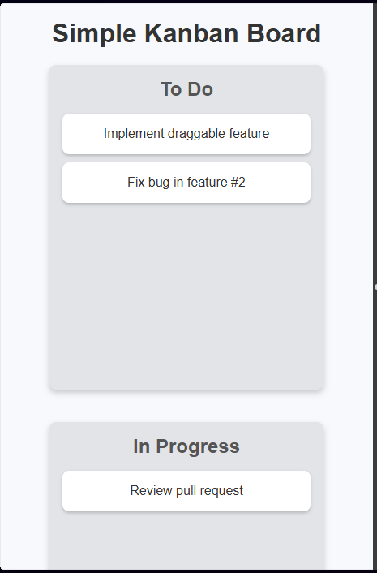
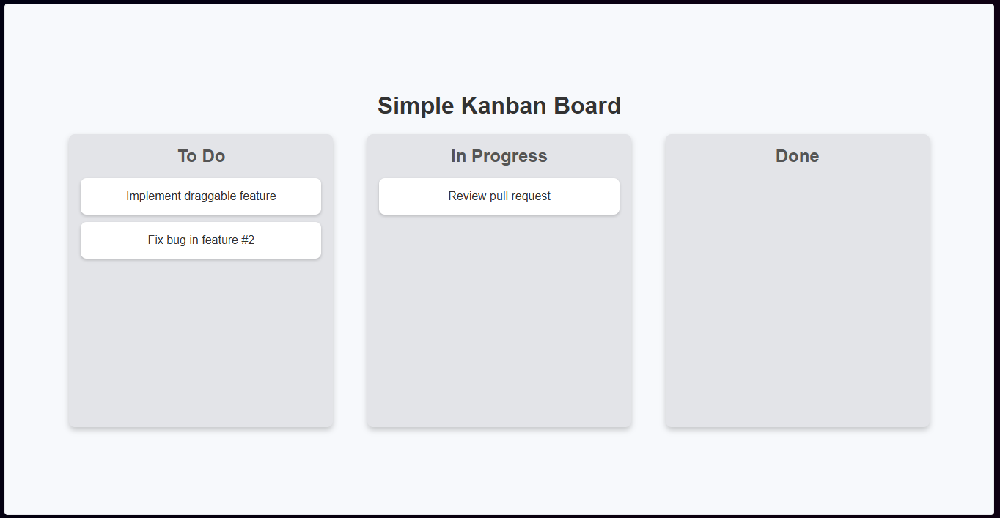
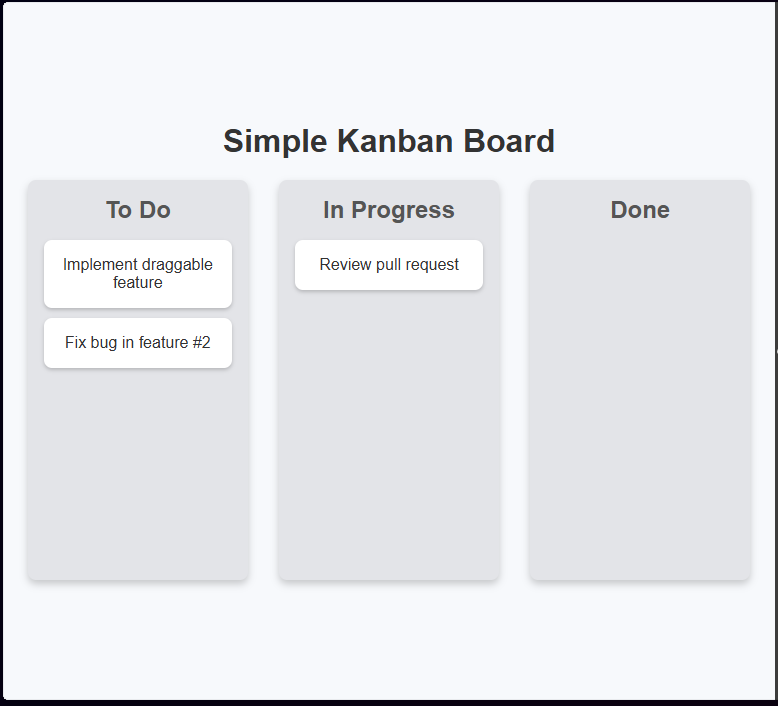
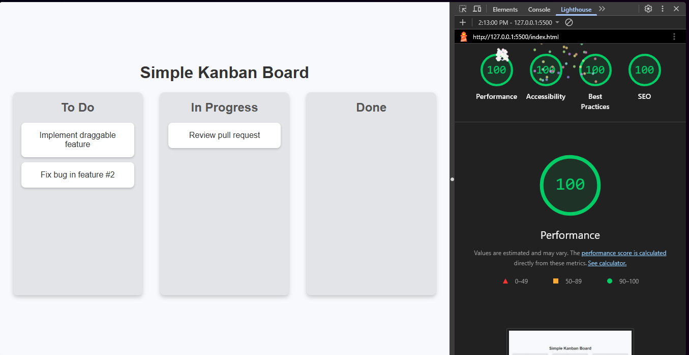

# Simple Kanban Board

A lightweight, responsive Kanban board built with plain HTML, CSS, and
JavaScript. Move task cards between **To Do**, **In Progress**, and **Done**
using drag and drop.

## Site previews

<table>
  <tr>
    <td rowspan="2" width="32%" align="center">
      <strong>Mobile</strong> 
      
    </td>
    <td width="68%" align="center">
      <strong>Desktop</strong> 
      
    </td>
  </tr>
  <tr>
    <td align="center">
      <strong>Tablet</strong> 
      
    </td>
  </tr>
</table>

## Site preview and metrics

The image below pairs the desktop site preview with its Lighthouse scores.

  

## Features

- Three task columns: To Do, In Progress, and Done.
- Drag-and-drop task cards between columns.
- Responsive layout that stacks columns on smaller screens.
- No frameworks or external dependencies.

## Run locally

Clone or download the project, then open `index.html` in a browser. For a local
development server, use the Live Server extension in Visual Studio Code or any
static file server.

## Project files

- `index.html` — board structure and sample tasks.
- `style.css` — board styling and responsive layout.
- `index.js` — drag-and-drop behavior.
- `previews/` — screenshots of the board and Lighthouse metrics.